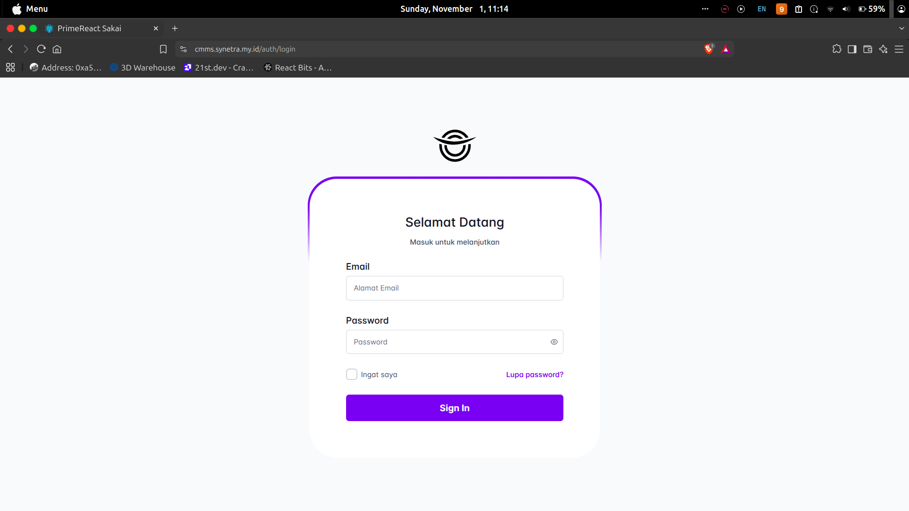
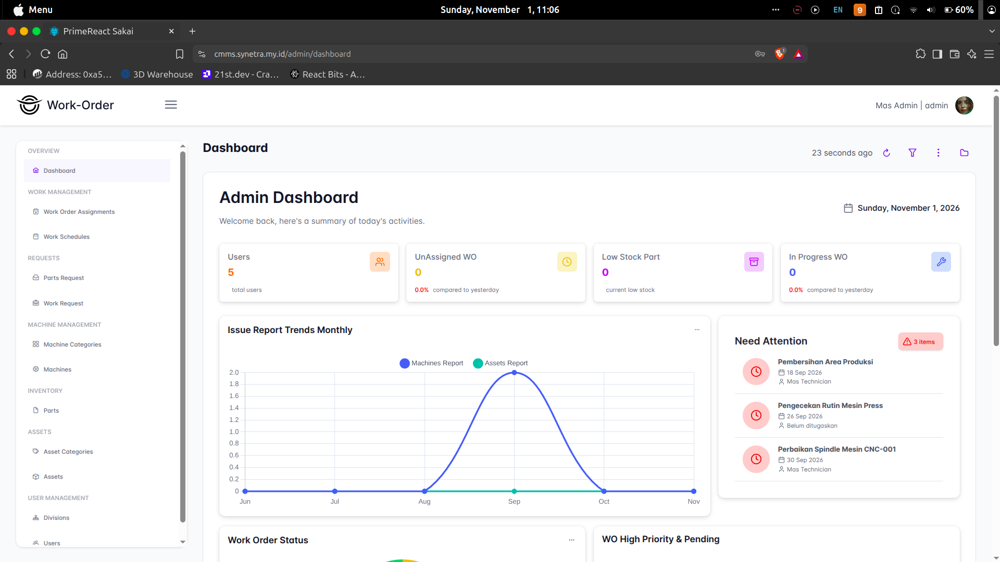
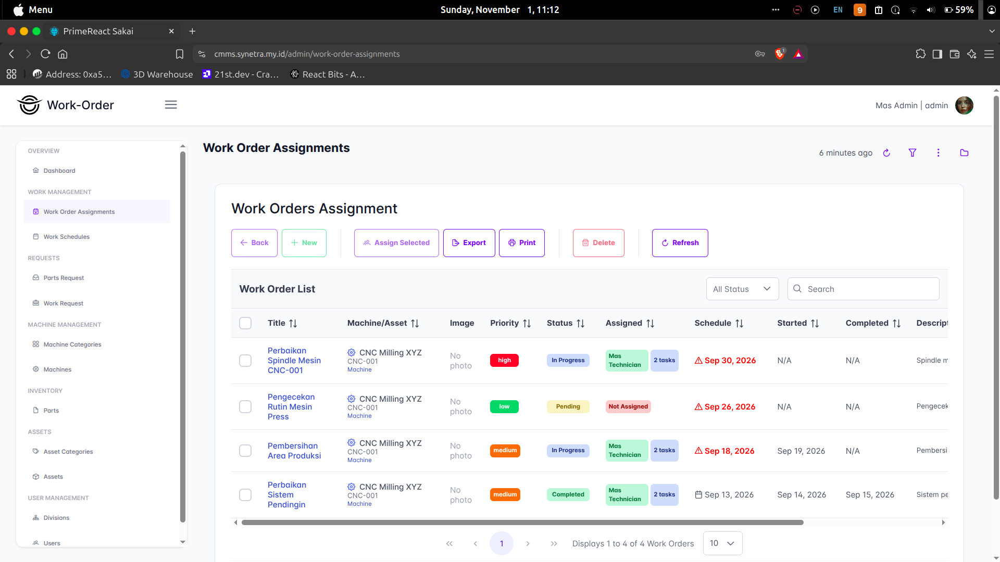
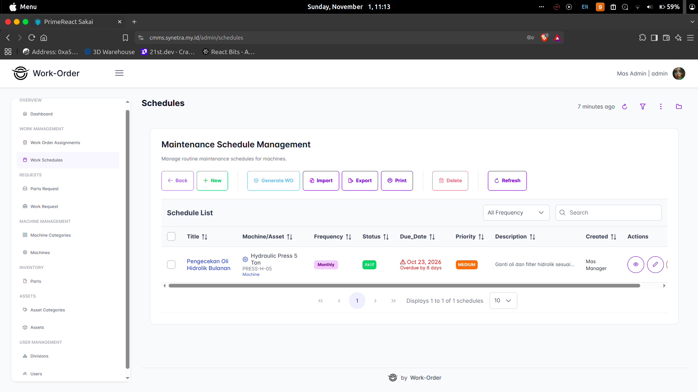
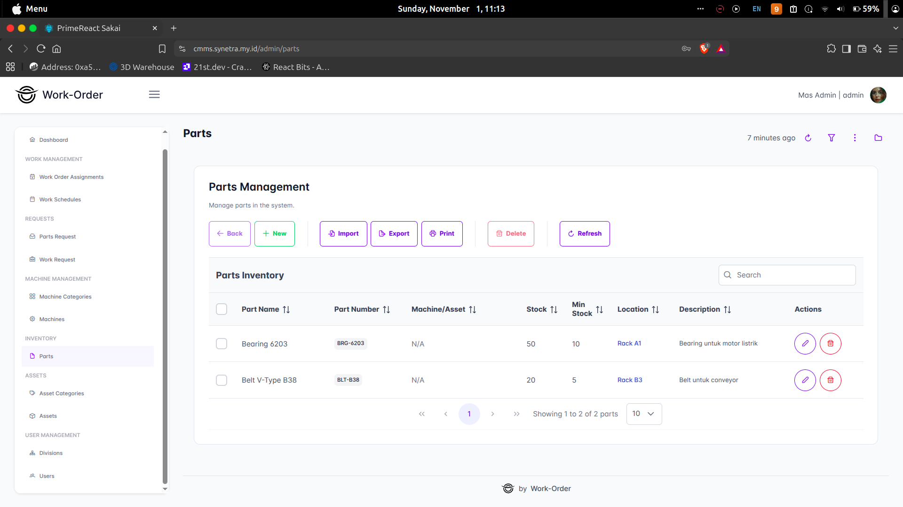
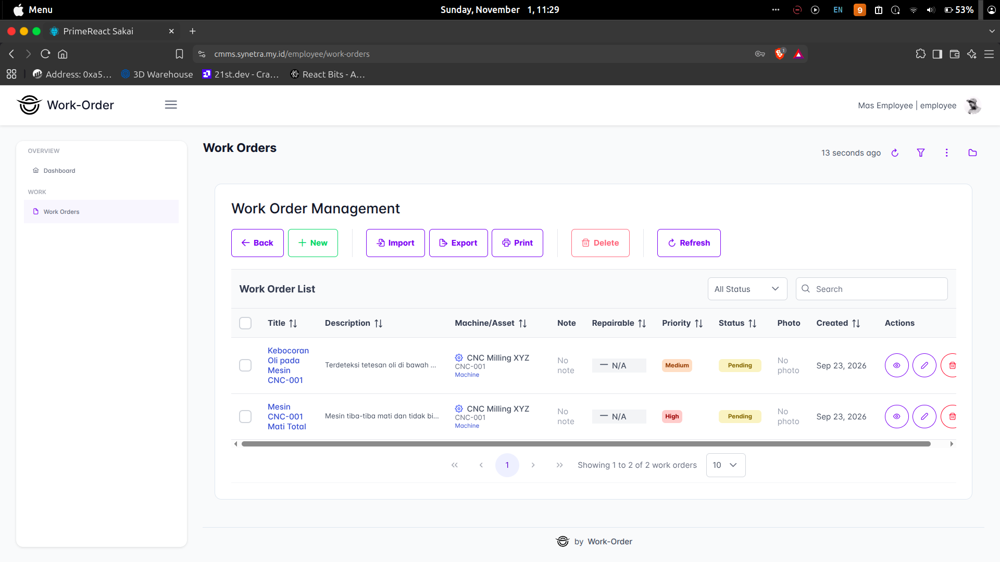
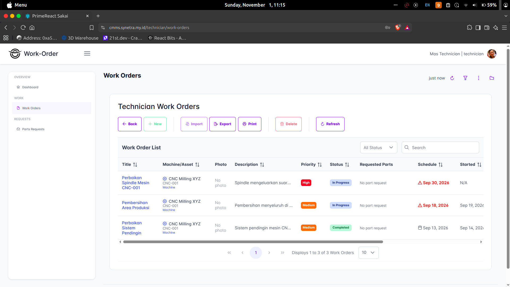

# Work Order Management System - Frontend

Aplikasi antarmuka berbasis web modern untuk Work Order Management System. Platform ini mengotomatisasi alur pelaporan kendala mesin (*issue reporting*), penugasan teknisi (*work order dispatch*), pemeliharaan berkala (*preventive maintenance*), dan kontrol inventaris suku cadang dengan UI responsif multi-role.

Repository Branch: `frontend`

---

## Daftar Isi
- [Tangkapan Layar & Antarmuka (UI Showcase)](#tangkapan-layar--antarmuka-ui-showcase)
- [Fitur Utama Berdasarkan Role](#fitur-utama-berdasarkan-role)
- [Teknologi & Dependensi](#teknologi--dependensi)
- [Struktur Direktori](#struktur-direktori)
- [Persyaratan Sistem](#persyaratan-sistem)
- [Instalasi & Menjalankan](#instalasi--menjalankan)
- [Konfigurasi Lingkungan (.env)](#konfigurasi-lingkungan-env)
- [Ekspor Laporan & Dokumen](#ekspor-laporan--dokumen)
- [Build & Deployment](#build--deployment)

---

## Tangkapan Layar & Antarmuka (UI Showcase)

Berikut adalah dokumentasi antarmuka dashboard dan modul fitur utama dalam sistem:

### 1. Halaman Autentikasi & Login
Halaman masuk dengan validasi kredensial pengguna, redirect otomatis sesuai peran (*role*), dan proteksi token berbasis cookie HTTP.



---

### 2. Dashboard Administrator
Ringkasan metrik analitik: total work order, rekapitulasi status penugasan (*Pending, On Progress, Completed*), rasio kendala mesin, dan kartu statistik operasional.



---

### 3. Manajemen & Penugasan Work Order (*Work Order Assignments*)
Tabel interaktif untuk penugasan work order kepada teknisi yang tersedia, penentuan prioritas, tenggat waktu, dan pelacakan status penanganan.



---

### 4. Jadwal Pemeliharaan Preventif (*Work Schedules*)
Kalender dan tabel jadwal servis berkala mesin untuk mencegah downtime mesin operasional.



---

### 5. Inventaris Suku Cadang & Permintaan Komponen (*Parts & Requests*)
Katalog suku cadang gudang, kontrol kuantitas minimum stok, dialog pengajuan suku cadang teknisi, dan persetujuan logistik.



---

### 6. Pelaporan Kendala Mesin Oleh Karyawan (*Issue Reporting*)
Formulir cepat pelaporan kendala mesin oleh operator atau karyawan divisi disertai unggah foto bukti kerusakan dan deskripsi kendala.



---

### 7. Lembar Kerja Teknisi (*Technician Execution & Part Usage*)
Antarmuka teknisi untuk melihat deskripsi tiket, mengubah status pengerjaan, mengajukan komponen cadangan, dan menyelesaikan work order.



---

## Fitur Utama Berdasarkan Role

| Role | Fitur Menu & Fungsionalitas |
| :--- | :--- |
| **Admin** | <ul><li>**Dashboard**: Metrik agregat seluruh operasional</li><li>**Work Management**: Work Order Assignments & Work Schedules</li><li>**Requests**: Approval Parts Request & Work Requests (Issues)</li><li>**Machine Management**: Master Data Mesin & Kategori Mesin</li><li>**Assets**: Master Data Aset & Kategori Aset</li><li>**Inventory**: Master Data Spare Parts</li><li>**User Management**: Manajemen Divisi & Pengguna</li></ul> |
| **Manager** | <ul><li>**Dashboard**: Analisis performa penyelesaian tiket dan grafik tren bulanan</li><li>**Management**: Monitoring Work Orders dan Kepatuhan Jadwal Pemeliharaan</li><li>**Oversight**: Pengawasan beban kerja teknisi dan kesiapan mesin pabrik</li></ul> |
| **Technician** | <ul><li>**Dashboard**: Work order aktif yang ditugaskan</li><li>**Work Orders**: Penanganan tiket perbaikan, catatan penanganan, & update status</li><li>**Part Requests**: Pengajuan kebutuhan suku cadang untuk perbaikan mesin</li></ul> |
| **Logistics** | <ul><li>**Dashboard**: Status ketersediaan stok komponen & tren pemakaian</li><li>**Inventory**: Manajemen katalog spare parts & penyesuaian stok</li><li>**Requests & Usage**: Pemrosesan pengajuan suku cadang dan audit riwayat pemakaian (*Part Usage*)</li></ul> |
| **Employee** | <ul><li>**Dashboard**: Ringkasan kendala mesin yang pernah dilaporkan</li><li>**Work Orders**: Form pengajuan perbaikan mesin (*Issue Submission*) dan monitoring progres</li></ul> |

---

## Teknologi & Dependensi

- **Core Framework**: [Next.js](https://nextjs.org/) v15 (App Router) & [React](https://react.dev/) v18
- **UI Component Library**: [PrimeReact](https://primereact.org/) v10
- **Utility CSS & Icon**: [PrimeFlex](https://primeflex.org/) & [PrimeIcons](https://primereact.org/icons/)
- **Visualisasi & Grafik**: [Chart.js](https://www.chartjs.org/), `react-chartjs-2`, & [Recharts](https://recharts.org/)
- **Animasi & Interaksi**: [Framer Motion](https://www.framer.com/motion/) & `@formkit/auto-animate`
- **Autentikasi & State**: `js-cookie`, `jwt-decode`
- **Ekspor Dokumen**: [jsPDF](https://github.com/parallax/jsPDF), `jspdf-autotable`, [ExcelJS](https://github.com/exceljs/exceljs), & `file-saver`
- **HTTP Client**: [Axios](https://axios-http.com/)

---

## Struktur Direktori

```text
frontend/
├── app/
│   ├── (full-page)/              # Rute layar penuh tanpa shell layout (login, error, not found)
│   │   └── auth/
│   │       ├── access/
│   │       ├── error/
│   │       └── login/
│   ├── (main)/                   # Rute terproteksi dengan Sidebar & Topbar
│   │   ├── admin/                # Halaman operasional Administrator
│   │   ├── manager/              # Halaman pengawasan Manager
│   │   ├── technician/           # Halaman kerja Teknisi
│   │   ├── logistics/            # Halaman inventaris & gudang Logistik
│   │   ├── employee/             # Halaman pelaporan Karyawan
│   │   └── profile/              # Pengaturan profil pengguna
│   ├── layout.jsx                # Root layout
│   └── page.jsx
├── components/                   # Komponen UI bersama (Dialog, Form, Table)
├── docs/
│   └── screenshots/              # Aset bukti tangkapan layar antarmuka
├── layout/                       # Layout wrapper Sakai (Topbar, Sidebar, Config, Menu)
├── middleware.js                 # Edge middleware untuk validasi route & role token
├── public/                       # Aset statis, ikon, dan tema PrimeReact
├── styles/                       # Konfigurasi SCSS tema dan utilitas
├── package.json
└── next.config.js
```

---

## Persyaratan Sistem

- Node.js `>= 18.x`
- npm, yarn, atau pnpm
- Server Backend Work Order yang sudah berjalan aktif

---

## Instalasi & Menjalankan

1. **Clone repository dan beralih ke branch frontend**:
   ```bash
   git clone -b frontend https://github.com/dimasprayogox/work-order.git
   cd work-order/frontend # atau cd work-order jika root branch frontend
   ```

2. **Pasang dependensi**:
   ```bash
   npm install
   ```

3. **Buat file environment**:
   ```bash
   cp .env.example .env.local # sesuaikan URL backend API
   ```

4. **Jalankan server development**:
   ```bash
   npm run dev
   ```

   Buka [http://localhost:3000](http://localhost:3000) pada browser Anda.

---

## Konfigurasi Lingkungan (.env)

Buat file `.env` atau `.env.local` pada direktori root frontend:

```env
# Alamat Backend API Express
NEXT_PUBLIC_API_URL=http://localhost:3000/api

# Konfigurasi opsional lainnya
NEXT_PUBLIC_APP_NAME="Work Order Management System"
```

---

## Ekspor Laporan & Dokumen

Sistem menyediakan fungsi ekspor laporan terintegrasi pada tabel kerja:
- **PDF Report**: Dihasilkan secara client-side menggunakan `jspdf` dan `jspdf-autotable` lengkap dengan header tabel, filter status, dan cap tanda tangan.
- **Excel Spreadsheet (.xlsx)**: Dihasilkan menggunakan `exceljs` dan `file-saver` untuk keperluan audit data operasional dan rekapitulasi inventaris.

---

## Build & Deployment

Untuk kompilasi produksi siap pakai:

```bash
# Build paket produksi
npm run build

# Menjalankan server produksi
npm run start

# Pemeriksaan linter kode
npm run lint
```
